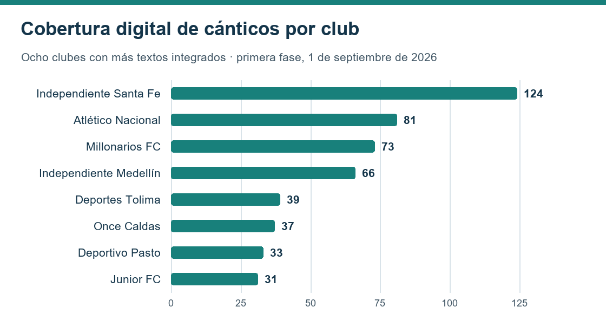

# Cánticos del fútbol colombiano | Construcción de corpus

Proyecto académico de **Procesamiento y Entendimiento del Lenguaje Natural** de la Universidad Nacional de Colombia. La primera fase construyó un corpus de cánticos asociados a los 20 clubes de la Liga BetPlay A de 2026, con reglas para verificar fuentes, preservar el lenguaje de los textos y documentar duplicados.

## Entregas finales

- [Cánticos del fútbol colombiano · PLN](entregas/pln_cuatro_fases_final.ipynb)

Cada cuaderno reúne las fases de la entrega académica, con el código y una selección de resultados agregados.

## Cuaderno técnico · las cuatro fases

[Ver el proyecto técnico de PLN](tecnico/pln_cuatro_fases.ipynb). Incluye preparación del corpus, diversidad léxica, TF-IDF y vectores contextuales, auditoría de similitud, clasificación *zero-shot* y reconocimiento de entidades.

[Abrir el resumen reproducible de la primera fase](analisis.ipynb).

Para probar las celdas, abre el cuaderno en Jupyter con un kernel que tenga `numpy`. El cuaderno documenta los insumos del experimento original.

## Qué quedó en el corpus

- Se integraron **600 cánticos** de **17 de los 20 clubes**. La fecha de corte de esta primera fase fue el **1 de septiembre de 2026**.
- Las 610 capturas iniciales incluyeron 10 duplicados exactos. El control de calidad dejó 88 registros marcados para revisión manual, sin tratarlos automáticamente como duplicados.
- Los tres clubes sin textos recuperados aparecen con cero en la tabla de cobertura. Ese cero describe las fuentes consultadas.



## Método y reproducción

La integración conserva el texto fuente en el corpus de trabajo. La comparación utiliza una representación de revisión independiente, registra la procedencia y documenta los cambios de identidad de clubes. La [versión de portafolio](analisis.ipynb) permite reproducir los controles sobre las [tablas agregadas](datos/). Los conteos reflejan cobertura digital y no miden lo que siente una hinchada ni la prevalencia general de una temática.

Con los dos CSV del proyecto académico, el script vuelve a contar observaciones por club a partir de sus identificadores y nombres. La redistribución de letras completas requeriría verificar las condiciones de las fuentes.

```bash
python contar_cobertura.py canticos.csv clubes.csv --salida cobertura_local.csv
```

**Fuentes de la primera fase** FanChants y Barrabrava.net, según la bitácora del proyecto. [Documentación metodológica original](https://drive.google.com/file/d/1NG-fPfCbhBrQ1z7qOv4yKR30NNLtK8L0/view)

**Crédito** Trabajo académico de Manuela Zapata Jiménez y David Cardona Duque. El resumen describe la construcción del corpus y el cuaderno técnico documenta las cuatro fases.

**English summary.** An NLP data-curation case study on Colombian football chants, documenting corpus coverage, exact duplicates and cases flagged for manual review. The technical notebook also covers text preparation, similarity, zero-shot classification and named entity recognition.
